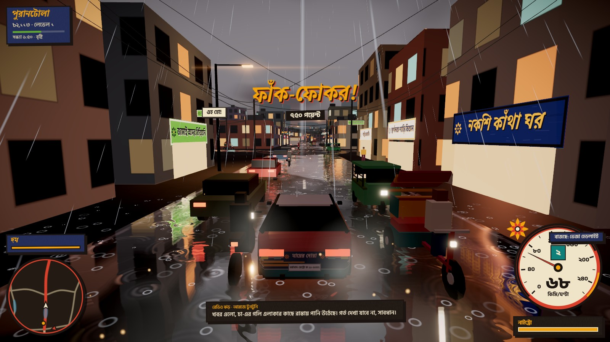
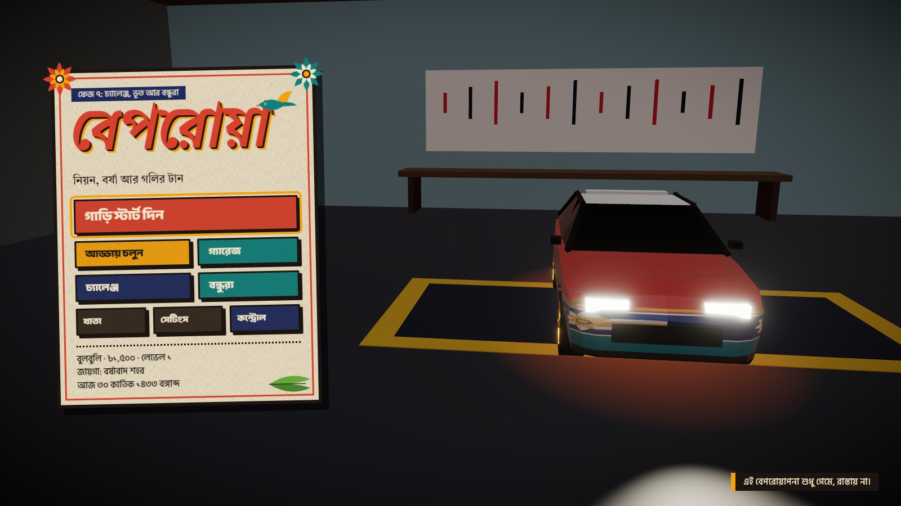
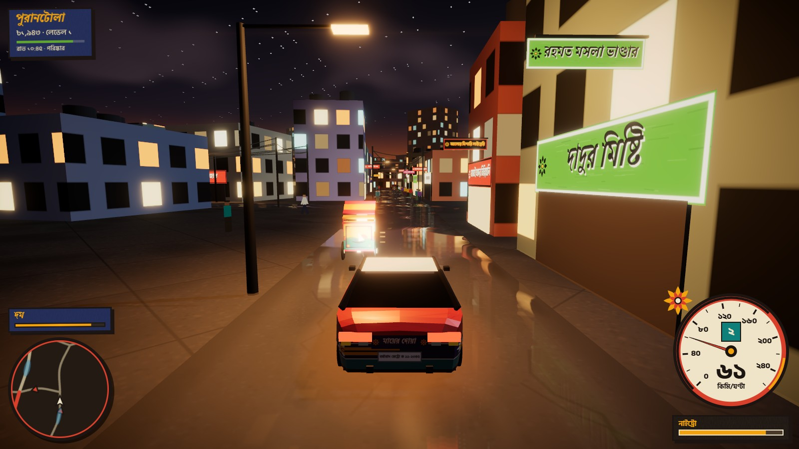
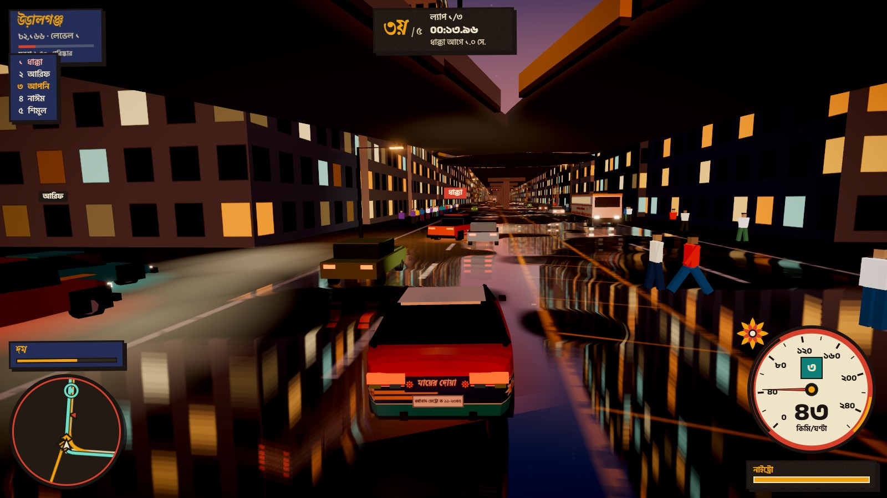
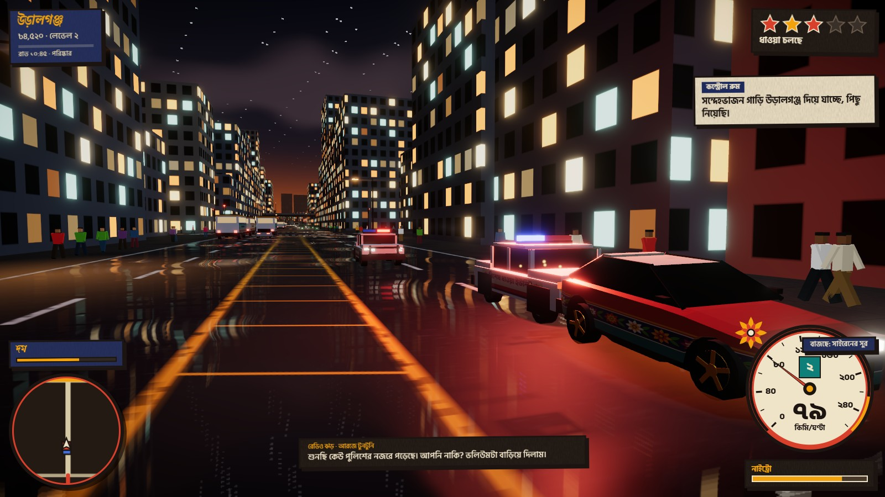
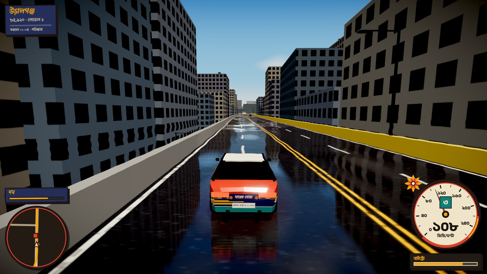
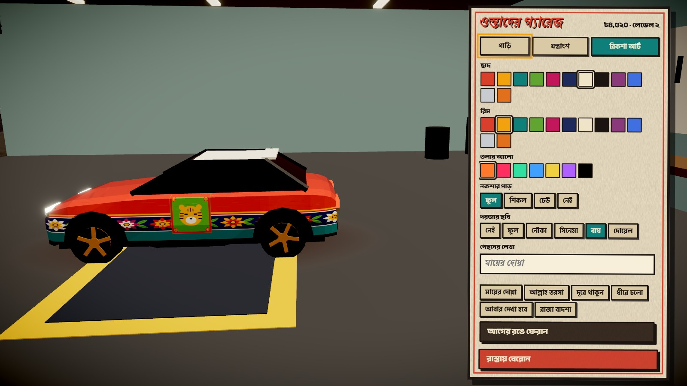
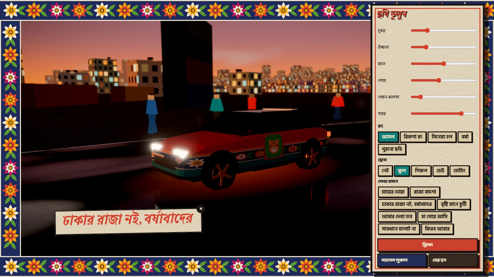
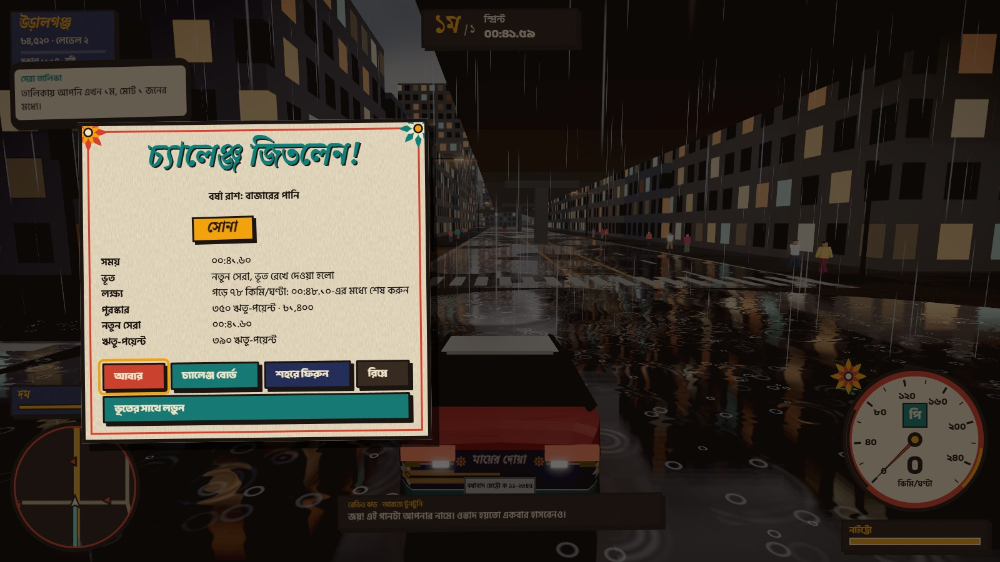
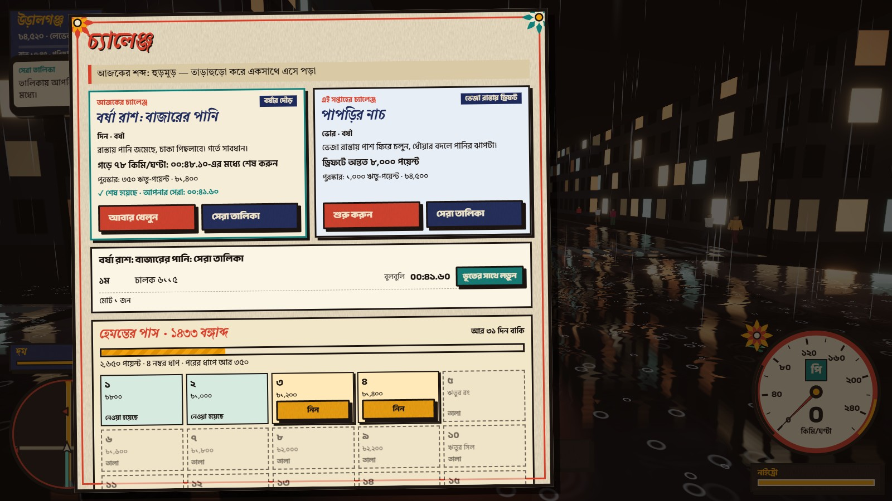

# বেপরোয়া

**বাংলা ভাষার ব্রাউজার স্ট্রিট রেসিং গেম।** রিকশা-পেইন্টের রং, ভেজা রাস্তায় নিয়নের আলো, আর বর্ষাবাদ নামের এক কাল্পনিক মহানগর।

Read in English: [README.md](README.md)



> **অবস্থা: সাতটা ফেজই তৈরি।** জীবন্ত শহরের তিনটা এলাকা, পুলিশি ধাওয়া, দ্য রিং, দশ গাড়ির গ্যারেজ, সারাদিনের আবহাওয়া, ফটো মোড, রিপ্লে, নিজস্ব গান, বাংলা রেডিও ডিজে, আর এখন ভূত, দৈনিক ও সাপ্তাহিক চ্যালেঞ্জ, বাংলা ঋতু ধরে বিনামূল্যের সিজন পাস, অনলাইন সেরা তালিকা, বন্ধুদের সাথে রেস, ফোন কাত করে স্টিয়ারিং, কাঁপুনি আর সহজে খেলার সেটিংস। পুরো পরিকল্পনা আছে [docs/GDD.md](docs/GDD.md) ফাইলে।

**লাইভ ডেমো:** এখনো ডিপ্লয় করা হয়নি।

## স্ক্রিনশট

সব ছবি গেমের ভেতর থেকেই তোলা, আল্ট্রা প্রিসেটে, ১৬০০×৯০০ মাপে। পর্দার সব লেখা গেমের নিজের বাংলা।

| | |
|---|---|
|  |  |
| **টাইটেল স্ক্রিন**, ওস্তাদের গ্যারেজে | **রাতের পুরানটোলা**: ভেজা রাস্তা, দোকানের সাইন, সামনে রিকশা |
|  |  |
| **বর্ষা**: ডোবা রাস্তা, বৃষ্টির বৃত্ত, আর পানি নিয়ে আরজে টুনটুনির সতর্কবার্তা | **দ্য রিং**: ফ্লাইওভারের নিচে পাঁচজনের মধ্যে তৃতীয়, সামনে রাইভালদের নামফলক |
|  |  |
| **তিন তারার ধাওয়া**: ঠিক পেছনে বিশেষ ধাওয়া ইউনিট, পুলিশের রেডিও আর ডিজের কথা | **দুপুরের ফ্লাইওভার**: একই শহর, এগারো ঘণ্টা পরে |
|  |  |
| **রিকশা-আর্ট লিভারি এডিটর**: নকশার পাড়, দরজার ছবি আর পেছনের লেখা | **ফটো মোড**: সূর্যাস্ত, ফুলের ফ্রেম আর বাংলা ক্যাপশন |
|  |  |
| **দৈনিক চ্যালেঞ্জ জেতা**: সোনা, ভূত রাখা, ঋতু-পয়েন্ট | **চ্যালেঞ্জ বোর্ড**: আজকের শব্দ, সেরা তালিকা আর হেমন্তের পাস |

## ফেজ ৭-এ যা কাজ করে

- **ভূত:** সময় মাপা প্রতিটা দৌড় ঠিকঠাক শেষ হলে সেকেন্ডে ১২ বার করে রেকর্ড হয়। প্রতিটা দৌড়ের সেরাটা এই যন্ত্রে রাখা থাকে, আর পরের বার পাশে একটা স্বচ্ছ গাড়ি হয়ে চলে, রেসের প্লেটের নিচে তার সাথে ব্যবধান দেখায়। রেসের পরে **ভূতের সাথে লড়ুন** চাপলে একা রাস্তায় নিজের সেরার সাথে আবার দৌড়।
- **দৈনিক ও সাপ্তাহিক চ্যালেঞ্জ:** একই দিনে সবাই একই চ্যালেঞ্জ পায়, বাংলাদেশ সময়ের তারিখ থেকে হিসাব করে, তাই এর জন্য কোনো সার্ভার লাগে না। সাথে থাকে আজকের একটা বাংলা শব্দ আর তার মানে। চ্যালেঞ্জগুলো আসে বোনাস মোড থেকে: সময়ের লড়াই, বর্ষার দৌড়, রাতের ডেলিভারি, কুয়াশার দৌড়, লোডশেডিং দৌড়, ভেজা রাস্তায় ড্রিফট, **জ্যাম থেকে পালান** (দ্বিগুণ ভিড়ে ঘড়ি ফুরানোর আগে পুলিশকে ঝেড়ে ফেলা) আর **ছবি শিকার** (ঠিক জায়গায়, ঠিক আলোয় গাড়ির ছবি)। চ্যালেঞ্জের দৌড় একা আর নির্দিষ্ট আকাশে হয়, রিংয়ের র‍্যাঙ্কে গোনে না।
- **বাংলা ঋতু ধরে বিনামূল্যের সিজন পাস:** বাংলা পঞ্জিকার ছয় ঋতু, গ্রীষ্ম থেকে বসন্ত, প্রতিটা প্রায় দুই মাস। চ্যালেঞ্জ, রেস, ভূত হারানো আর পুলিশ থেকে পালানো থেকে ঋতু-পয়েন্ট আসে, তা দিয়ে ১৫টা ধাপ: টাকা, গ্যারেজের জন্য ঋতুর রং আর আলো, আর চিরকাল রাখার মতো একটা সিল। কোনো কিছুর দাম নেই, কেনারও কিছু নেই।
- **অনলাইন সেরা তালিকা:** একটা Netlify Function প্রতিটা সময়-মাপা দৌড় আর প্রতিটা দৈনিক ও সাপ্তাহিক চ্যালেঞ্জের তালিকা রাখে, Netlify Blobs-এ। সময়ের সাথে তার ভূতও পাঠাতে হয়; সার্ভার সেটা সময়, শুরুর জায়গা আর গতির সীমার সাথে মিলিয়ে দেখে। নাম ছেঁকে নেওয়া হয়, আর সংযোগ বা যন্ত্রের শুধু লবণ-মেশানো হ্যাশ রাখা হয়, কোনো ঠিকানা নয়। প্রথম দশজনের ভূত থেকে যায়, তাই অন্যের দৌড়ের সাথেও লড়া যায়। সার্ভার না থাকলে তালিকা সেটা জানায় আর আপনার নিজের সেরাটা দেখায়।
- **বন্ধুদের সাথে রেস (ঐচ্ছিক):** `server/` ফোল্ডারে ছোট্ট একটা WebSocket রিলে। রুম খুলে চার অক্ষরের কোড পাঠালে ছয়জন রেসার আর আটজন দর্শক যোগ দিতে পারে। রুমের মালিক রেস বাছে, সবাই একই মুহূর্তে শুরু করে। বন্ধুদের গাড়ি তাদের পাঠানো অবস্থান থেকে আঁকা স্বচ্ছ ভূত, নামফলক আর মিনিম্যাপে ত্রিভুজসহ; বন্ধুরা শেষ করলে ফলাফলে তাদের সময় আসে। দর্শকেরা যেকোনো রেসারের পেছনে ক্যামেরা পায়, ← → দিয়ে বদলায়।
- **নিয়ন্ত্রণ:** ফোনে স্টিয়ারিং বোতাম, স্লাইডার বা ফোন কাত করে, সাথে "সোজা" বোতাম আর দিক উল্টানোর সেটিং। গেমপ্যাডে কাঁপুনি: ধাক্কা, পুলিশের ছোঁয়া, নাইট্রো, গর্ত, ফাঁদ, কাউন্টডাউন আর শেষ রেখায়; ফোনে জোর ধাক্কায় ছোট্ট কম্পন। কন্ট্রোল স্ক্রিনে চালানোর সব কি বদলানো যায়; এন্টার, এস্কেপ, P, ট্যাব আর ` জায়গায় থাকে, যাতে মেনু সবসময় কাজ করে।
- **সবার জন্য সহজ:** লাল, সবুজ বা নীল কম দেখেন এমন চোখের জন্য আলাদা রং, আর মিনিম্যাপের প্রতিটা চিহ্নের নিজস্ব আকৃতি (রেসার হীরা, পুলিশ চৌকো, বন্ধু ত্রিভুজ, গন্তব্য বৃত্ত)। সাবটাইটেল ছোট থেকে অনেক বড়, পেছনে গাঢ় পট রাখার সুবিধা, আর বেশি কনট্রাস্ট মোড। আগের ফেজের কম নড়াচড়ার সেটিং সবখানেই কাজ করে।
- **ঐচ্ছিক এআই-লেখা লাইন, শুরুতে বন্ধ:** সেটিংসে চালু করলে, আর সাইটের মালিক চাবি দিয়ে থাকলে, প্রতিপক্ষ আর আরজে টুনটুনির কিছু লাইন একটা Netlify Function দিয়ে ক্লড সাথে সাথে লিখে দেয়। লাইন আগে থেকে আনা থাকে, তাই কিছুই অপেক্ষা করে না; প্রতিটা লাইনের দৈর্ঘ্য, লিপি, খারাপ শব্দ, ধর্ম আর রাজনীতি যাচাই হয়, আর পাশে "এআই" চিহ্ন থাকে। চাবি না থাকলে বা অফলাইনে আগের লেখা লাইনই চলে।
- **মান:** নিচু থেকে আল্ট্রা প্রিসেট, ডায়নামিক রেজোলিউশন আর জিপিইউ চেনা ফেজ ১ থেকেই আছে। এখন জিপিইউ চেনার সময় যন্ত্রের মেমরি আর কোরও দেখে, আর নতুন ফোনের জিপিইউ মাঝারি প্রিসেটে শুরু হয়।

## ফেজ ৬ থেকে যা আছে

- **পুরো একটা দিন:** পূর্বে সূর্য ওঠে, পশ্চিমে ডোবে, ১৮ মিনিটে। সময়ের সাথে আকাশ, কুয়াশা, আলো আর রং বদলায়। সন্ধ্যায় জানালা আর ল্যাম্প জ্বলে, রোদের জায়গা নেয় দোকানের বোর্ড। আকাশে সূর্য, চাঁদ, তারা আর ভেসে যাওয়া মেঘ।
- **ক্যালেন্ডার ধরে আবহাওয়া:** পরিষ্কার, বর্ষা আর কুয়াশা, একটা থেকে আরেকটায় মিশে যায়, আসল মাস দেখে। বর্ষার মাসে বৃষ্টি, শীতে কুয়াশা। সেটিংসে সময় বা আবহাওয়া আটকে রাখা যায়।
- **বর্ষা:** চলতে গেলে বৃষ্টি হেলে আসে, রাস্তায় বৃত্ত, বজ্র আর বিদ্যুৎ। রাস্তা সত্যিই ভেজে আর পিছলা হয়: পুরো ভিজলে গ্রিপ ১২% কমে, এআই ড্রাইভাররাও বাঁকে গতি কমায়। পরে ধীরে শুকায়।
- **জলাবদ্ধতা:** লম্বা বৃষ্টিতে আটটা নিচু রাস্তায় পানি জমে। পানি গাড়ি টেনে ধরে, জোরে গেলে চাকা ভাসে, স্টিয়ারিং হালকা হয়, পানি ছিটকায়, আর পানির নিচে গর্ত লুকানো। শুধু নিচতলার রাস্তা ডোবে। নিচু জায়গাগুলো ম্যাপে দাগ দেওয়া।
- **লোডশেডিং:** অন্ধকার হলে বিদ্যুৎ চলে যেতে পারে। অন্ধকার এক জায়গা থেকে ছড়ায়, চোখে দেখা যায়। জানালা আর ল্যাম্প নেভে, থাকে শুধু দোকানের বোর্ড আর আপনার হেডলাইট। পুলিশও কম দেখে।
- **কুয়াশা:** সামনের দৃষ্টি একদম কমে যায়, পুলিশও দ্রুত হারায়। ল্যাম্পের আলো দাগের মতো দেখা যায়।
- **বর্ষা রাশ:** রিংয়ে দুটো নতুন রেস, শুধু বর্ষায়, পানি আগে থেকেই ওঠা।
- **ভেজা নিয়ন রাস্তা:** নিচু জায়গায় ডোবা, প্রতিটা ফোঁটায় বৃত্ত, লম্বা হয়ে ভাঙা নিয়নের ছায়া। দিনের শুকনো রাস্তা সত্যিই শুকনো।
- **লেন্স ফ্লেয়ার আর গরম বাতাস:** সূর্য কিছুর আড়ালে না থাকলেই ফ্লেয়ার, দুপুরে রাস্তা কাঁপে। ল্যাম্পের আলো লেন্সে ছড়ায়, বৃষ্টিতে আরও।
- **ফটো মোড (O, অথবা বিরতি মেনু):** সব থেমে যায়। গাড়ির চারপাশে ঘুরুন, লেন্স, কাত আর পেছন ঝাপসা ঠিক করুন, সময় টানুন, রং বাছুন, রিকশা আর্টের ফ্রেম দিন, আর বাংলা লেখা টেনে বসান, তৈরি অথবা নিজের। পুরো রেজোলিউশনে পিএনজি সেভ হয়।
- **রিপ্লে:** শেষ চালানোটুকু সবসময় জমা থাকে, ট্রাফিক, পুলিশ আর রাইভালসহ। সাত রকম শটে পরিচালক কাটেন, ধাক্কা আর গা ঘেঁষার সময় ধীর হয়। ক্যামেরা, গতি, টেনে সরানো, আর সেখান থেকে ছবি তোলা। বিরতি মেনু বা রেসের ফলাফল থেকে খোলে।
- **গান যা পরিস্থিতি বোঝে:** নিজস্ব, চলতে চলতে তৈরি হয়, কোনো রেকর্ডিং বা ধার করা সুর নেই। ঘোরাঘুরিতে লো-ফাই, ধাওয়ায় ট্র্যাপ আর ফঙ্ক, রেসে ঢোল, চায়ের দোকানে তবলা আর একতারা, বৃষ্টি আর লোডশেডিংয়ে পাতলা আর গাঢ়। তারা, গতি আর রেস দেখে চলে, বারের মাথায় বদলায়। স্কেল বাংলা ধাঁচের। ঢোল, তবলা, একতারা, বাঁশি সবই সিন্থে বানানো কাছাকাছি শব্দ।
- **রেডিও ঝড়:** আরজে টুনটুনি কথা বললে গান নিচে নেমে যায়। তারা, পালানো, ধরা পড়া, জয়, ধাক্কা, বৃষ্টি, কুয়াশা, লোডশেডিং আর সময় নিয়ে বলেন। ম্যাপের আসল জায়গা ধরে আবহাওয়া আর জ্যামের খবর, মজার বিজ্ঞাপনও। Y চাপলে: গান আর ডিজে, শুধু গান, অথবা বন্ধ।
- **আরও শব্দ:** বৃষ্টি, বজ্র, ভেজা চাকা, পানির স্রোত, ভোরে পাখি, রাতে ঝিঁঝিঁ, আর শেষমেশ গ্যারেজেও কিছু শব্দ।

## ফেজ ৫ থেকে যা আছে

- **ওস্তাদের গ্যারেজ:** রাস্তার ধারে সত্যিকারের কারখানা, টাইটেল স্ক্রিনের পেছনেও এটাই। গাড়ি নিয়ে ঢুকে আস্তে হন, অথবা মেনু থেকে যান। টেনে ক্যামেরা ঘোরানো যায়।
- **দশটা নিজস্ব গাড়ি, তিন শ্রেণি আর একটা গোপন:** গলি (বুলবুলি, শালিক, ফড়িং), সড়ক (ইলিশ, মাছরাঙা, চিতল), উড়াল (বাজপাখি, শঙ্খচিল, বাঘা)। প্রত্যেকটার শক্তি, গতি, গ্রিপ, ব্রেক, নাইট্রো আর স্টিয়ারিং আলাদা। পুরো রিং জিতলে ওস্তাদ এক টাকায় বেচবেন **রিকশা রকেট**: হুড, ঝালর আর দুই বড় নলসহ এক রিকশা।
- **ছয় রকম যন্ত্রাংশ, তিন ধাপে:** ইঞ্জিন, টার্বো, চাকা, সাসপেনশন, ব্রেক, নাইট্রো। চালানোর ধরন সত্যিই বদলায়।
- **ডাইনো গ্রাফ:** গতির সাথে শক্তি। আসল, এখন, আর পরের যন্ত্রাংশে কী হবে। ক্রসহেয়ার, কিবোর্ড আর সংখ্যার টেবিলও আছে।
- **রিকশা আর্ট:** গাড়ির ছয় জায়গার রং, ফুল-শিকল-ঢেউয়ের পাড়, আর দরজায় বাঘ, দোয়েল, নৌকা, ফুল বা সিনেমার মুখ। পেছনে নিজের বাংলা লেখা বসান, গালি আটকানোর ফিল্টারসহ, অথবা তৈরি লেখা বেছে নিন।
- **টাকা, সুনাম আর লেভেল:** রেস, স্টান্ট, পালানো আর কাজে টাকা আসে। সুনামে লেভেল বাড়ে, লেভেলে ভালো যন্ত্রাংশ খোলে। ধরা পড়লে সত্যি টাকা যায়। HUD-এ বাংলা সংখ্যায় ঘুরন্ত টাকার হিসাব।
- **গাড়ির হাল:** ধাক্কায় গাড়ি খারাপ হয়। ৫৫%-এর নিচে শক্তি কমে, ৩২%-এর নিচে ধোঁয়া বেরোয়। গ্যারেজে পুরো সারে।
- **চায়ের দোকান:** পুরানটোলায় তিনটা। এক কাপ চায়ে, ছোট্ট কেটলি-অ্যানিমেশনসহ, নাইট্রো ভরে, পাংচার সারে, গাড়ি ৭০% পর্যন্ত ঠিক হয়, আর জায়গাটা সেভ হয়। পরের বার সেখান থেকেই শুরু।
- **আড্ডা:** মকবুল মামা, খোকন ভাই, রুমকি, লতিফ চাচা বা ডালিমের পাশে বসুন। ছোট বাংলা আলাপ, গুজব আর সাইড কাজ। গুজবগুলো রাইভালের সত্যিকারের দুর্বলতা বলে দেয়, আর রিং বোর্ডে লেখা থাকে।
- **সাইড কাজ:** আটটা। ঘড়ির বিপক্ষে GPS ধরে পৌঁছানো থেকে গা ঘেঁষে চালানো, ড্রিফট আর পুলিশকে ফাঁকি।
- **আড্ডা মোড:** পুলিশ ছুটিতে, শুধু শহরে ঘোরা। টাইটেল বা বিরতি মেনু থেকে চালু করুন।
- **২৬টা অর্জন**, বেশিরভাগের নাম পুরনো বাংলা প্রবাদে, ফোনে **প্রতিদিনের বকশিশ**, আর সবকিছুর হিসাবের **খাতা**।
- **রাইভালও এগোয়:** আপনার গাড়ি দেখে ওদের ইঞ্জিনও কিছুটা বাড়ে। আপগ্রেডে লাভ হয়, তবে রেস সহজ হয়ে যায় না।
- **সেভ** এখন IndexedDB-তে, স্কিমা নম্বরসহ। পুরনো সেভ নতুন রূপে আসে, আগের অর্জনের টাকাও পায়।

## ফেজ ৪ থেকে যা আছে

- **দ্য রিং:** টপ টেন বোর্ডে ওপরে উঠুন। প্রত্যেক রাইভালের নিজের ছবি, গাড়ি, চালানোর ধরন আর বাংলা সংলাপ আছে। প্রথমে একটা প্রস্তুতি রেস, তারপর রাইভালের নিজের রেস। বোর্ডের একটা সুইচে সব রেস খুলে দেওয়া যায়, শুধু দেখতে চাইলে।
- **বারো রকম ইভেন্ট:**
  - সার্কিট আর স্প্রিন্ট, দুই এলাকার রাস্তায়।
  - **উড়াল চক্র:** পুরো উড়ালপথে চক্কর, টোল বুথের পাশ দিয়ে।
  - **নদীর ঘাট:** নতুন কাজলঘাট বন্দরে, কনটেইনারের ফাঁকে আর ক্রেনের নিচে।
  - **বাজার ধাঁধা:** গেটগুলো গলির ভেতর, পথ দেখানো হয় না। পথ খুঁজে বের করাটাই রেস।
  - **ড্র্যাগ:** হ্যান্ডব্রেক বোতামই গিয়ার। আগে বদলালে ইঞ্জিন ঝিমায়, দেরি করলে আর টানে না।
  - **ড্রিফট:** ঘড়ির বিপক্ষে পয়েন্ট তুলুন, আর নিজের রেসে পাপড়ির বিপক্ষে।
  - **ঘড়ি দৌড়**, সময় দেখে মেডেল।
  - **শিকার:** গাড়িগুলো পালায়, জোরে ধাক্কা দিলে থামে। পাশ থেকে মারলে বেশি কাজ হয়। কেউ আহত হয় না।
  - **ডেলিভারি:** ভাঙা-ভঙ্গুর মাল কয়েক ঠিকানায়। ধাক্কায় মাল ভাঙে, আর আস্তে চালিয়ে হাতে দিতে হয়।
  - **গেট রাশ:** সময় বাড়ে শুধু গেটে গেটে।
  - **বস রেস:** জাহান, তিন ধাপে। উড়ালপথ থেকে গলি হয়ে নদী, মাঝপথে পুলিশ।
- **রাইভালের ব্যক্তিত্ব:** কেউ গলি কেটে যায়, কেউ ভুল করে না, কেউ মাফ চেয়ে ধাক্কা দেয়, কেউ পাশ ফিরে বাঁক নেয়, কেউ সোজায় দানব কিন্তু গলিতে দুর্বল, কেউ পথ আটকায়, কেউ বাতি নিভিয়ে হর্নে ট্রাফিক সরায়, কেউ সব জমিয়ে রাখে শেষ ল্যাপের জন্য।
- **ন্যায্য রাবার-ব্যান্ডিং:** অল্প, দুই দিকেই সীমা বাঁধা, আর শেষের আগে পুরো মিলিয়ে যায়। শেষটা নিজের জোরেই জিততে হয়। রাইভালও একই ফিজিক্সে চলে।
- **ওরা আপনাকে মনে রাখে:** কোন পাশে কাটান, কখন প্রথম নাইট্রো চাপেন, কত ধাক্কা খান, কত ব্যবধানে জেতেন। জাহান এসব দেখেই পরিকল্পনা করে। ক্যারিয়ারের সঙ্গে সেভ থাকে।
- **শুরু ও শেষ:** বাতি আর ভিড়সহ স্টার্ট লাইন, ঠিক সময়ে গ্যাস চাপলে দারুণ স্টার্ট, গ্রিডের ওপর দিয়ে ক্যামেরা, রেসের আগে রাইভালের মুখ ও কথা, আর শেষে ফলাফল বোর্ড।
- **নতুন এলাকা, কাজলঘাট:** নদীবন্দর। কনটেইনারের স্তূপ, ক্রেন, বার্জ, লঞ্চ আর নৌকা, কাজলগঙ্গার তীরে।
- **হর্ন ভাষা:** রাইভালের কাছে দুই টোকা দিলে সে খেপে যায়। আরও জোরে চালায়, ভুলও বেশি করে।
- **শহরে:** রাস্তার ধারে রেসের পতাকা। পাশে থামলেই ঢোকা যায়, অথবা G চাপলে বোর্ড। ওস্তাদ ফোনে খবর পাঠান।

## ফেজ ৩ থেকে যা আছে

- **বিশেষ ধাওয়া ইউনিট:** কাল্পনিক পুলিশ বাহিনী। টহল গাড়ি শহরে ঘোরে। আপনাকে জোরে চালাতে, ধাক্কা মারতে বা ওদের গায়ে লাগাতে দেখলে ধাওয়া শুরু করে। ওদের গাড়িও আপনার মতো একই ফিজিক্স ও কন্ট্রোলে চলে, তাই ঘিরে ধরা মানে সত্যিকারের গাড়ি পথ আটকে দাঁড়ানো।
- **তাপ ১ থেকে ৫:** পাঁচটা আঁকা তারা। ধাওয়া যত লম্বা আর যত বেপরোয়া, ইউনিট তত বেশি, গতি তত বেশি, খোঁজাও তত লম্বা।
- **স্তর অনুযায়ী কৌশল:** এক তারায় ধাওয়া, দুই তারায় ঘিরে ধরা, তিন তারায় পিছনের কোণায় গুঁতো, চার তারায় সোজা ধাক্কা। সবই আপনার গতিপথ দেখে।
- **ব্যারিকেড ও কাঁটা:** সামনের রাস্তায় ব্যারিকেড, তবে একটা ফাঁক সবসময় থাকে। চার তারা থেকে সেই ফাঁকে কাঁটা, আর ইউনিটও সামনে কাঁটা ফেলে। পাংচার হলে গতি, শক্তি আর গ্রিপ কমে যায়, কিছুক্ষণ পর ঠিক হয়।
- **ড্রোন ও হেলিকপ্টার:** তিন তারায় ড্রোন, ব্যাটারি অল্প। পাঁচ তারায় সার্চলাইটসহ হেলিকপ্টার। দুটোকেই গতিতে পিছনে ফেলা যায়, আর ছাদের নিচে গেলে ওরা দেখতে পায় না।
- **পালানোর উপায়:** চোখের আড়াল হওয়াই একমাত্র পথ। পার্কিং, চায়ের দোকানের ভিড়, গলি আর উড়ালপথের নিচে গেলে খোঁজা তাড়াতাড়ি শেষ হয়। ম্যাপে সব চিহ্ন দেওয়া আছে।
- **গ্রেফতার:** ইউনিটের পাশে থেমে গেলে একটা মিটার ভরতে থাকে। ইউনিট যত বেশি, তত দ্রুত। জরিমানা দিয়ে আবার রাস্তায়।
- **ঝামেলা-ফাঁদ:** রাস্তার ধারে বাঁশের মাচা, ড্রামের স্তূপ আর পানির ট্যাংক। গুঁতো দিলে রাস্তায় ভেঙে পড়ে, কাছের ইউনিট আটকে যায়, আর সময় মুহূর্তের জন্য ধীর হয়।
- **দম:** দম ধরলে সময় ধীর হয়, শব্দ চাপা হয়ে আসে। গা ঘেঁষে যাওয়া, ফাঁক গলে বের হওয়া, ড্রিফট আর ফাঁদে এটা আবার ভরে।
- **তিন টোকা হর্ন:** কাছের ইউনিট কিছুক্ষণের জন্য দিশা হারায়, পুরো ট্রাফিক হর্নে যোগ দেয়। আবার ব্যবহার করতে একটু সময় লাগে।
- **বাংলা পুলিশ রেডিও:** কন্ট্রোল রুম আর চিফ রেজওয়ান তালুকদারের কথা পর্দায় আসে, যা ঘটছে তার সঙ্গে মিলিয়ে। ব্রাউজারে বাংলা ভয়েস থাকলে পড়েও শোনাতে পারে (সেটিংসে, ডিফল্টে বন্ধ)।
- **নিজে থেকে মানিয়ে নেওয়া কঠিন্য:** বারবার ধরা পড়লে পুলিশ একটু ঢিলা দেয়, সহজে পালালে আরও চাপ দেয়। পরের বার খেলার জন্যও মনে থাকে।
- **সাউন্ড:** কাছের ইউনিটের দিক থেকে আসা দুই সুরের সাইরেন, হেলিকপ্টারের পাখা, ড্রোনের শব্দ আর রেডিওর ক্লিক, সব কোডে তৈরি।

## ফেজ ২ থেকে যা আছে

- **বর্ষাবাদের দুই এলাকা:** পুরানটোলার বাঁকা গলি আর বাজারের রাস্তা, উড়ালগঞ্জের চওড়া সড়ক। প্রায় ১৫ কিমি রাস্তা, মাঝখানে স্মৃতিস্তম্ভের চত্বর।
- **উড়ালপথ:** ২.৬ কিমির উঁচু লুপ, চারটা র‍্যাম্প, ব্যারিয়ার, পিলার আর টোল প্লাজা।
- **ট্রাফিক:** হাতে আঁকা প্যানেলের রিকশা, সিএনজি, বাইক, গাড়ি, পিকআপ আর ট্রাক-আর্টের বাস। বাংলাদেশের মতো রাস্তার বাম দিক দিয়ে চলে, দূরত্ব রাখে, মোড় আর ঘড়ির কাঁটার দিকে চত্বর পার হয়।
- **সিগন্যাল:** ১৬টা মোড়ে চালু বাতি। লাল বাতিতে কোনো গাড়ি পার হয় না।
- **জ্যাম জোন:** যানজটের রাস্তা, থেমে থেমে চলে, বাইকগুলো লেনের ফাঁক দিয়ে বের হয়।
- **ফাঁক-ফোকর:** গা ঘেঁষে গেলে বোনাস। দুই গাড়ির ফাঁক দিয়ে বের হলে বড় বোনাস আর নাইট্রো।
- **হর্ন ভাষা:** এক টোকায় গাড়ি সরে যায়, লম্বা হর্নে মানুষ পথ ছাড়ে, দুই টোকায় সবাই পাল্টা হর্ন দেয়। চালাতে চালাতে ওস্তাদ শিখিয়ে দেন।
- **মানুষ:** ফুটপাতে হাঁটে, দোকানে জটলা করে। সবসময় সরে যায়, কারও গায়ে কখনো লাগে না।
- **ধাক্কা:** বাস আপনাকে থামিয়ে দেবে, রিকশায় গতি প্রায় কমে না। কেউ আহত হয় না।
- **ম্যাপ ও জিপিএস:** ঘোরানো মিনিম্যাপ, পুরো ম্যাপ, বাংলায় ডানে-বামের নির্দেশ, পথ ভুল করলে নতুন রুট, গন্তব্যে আলোর স্তম্ভ।
- **শহরের খুঁটিনাটি:** ঝুলন্ত বাংলা সাইনবোর্ড, ধোঁয়া-ওঠা চায়ের দোকান, মসলা ও কাপড়ের দোকান, প্যাঁচানো দুলতে থাকা তার, বিলবোর্ড, ছাদের পানির ট্যাংক, আর হর্ন ও রিকশার ঘণ্টায় ভরা শহরের শব্দ।

## ফেজ ১ থেকে যা আছে

- **আর্কেড ড্রাইভিং:** Rapier ফিজিক্সের ওপর নিজস্ব রেকাস্ট গাড়ি। সাসপেনশন, গ্রিপ, হ্যান্ডব্রেক ড্রিফট, অটো কাউন্টার-স্টিয়ার, স্পিন লিমিটার, নাইট্রো আর ৬ গিয়ারের অটো গিয়ারবক্স।
- **টেস্ট রোড:** ৩.৮ কিমির সার্কিট আর ড্রিফট মাঠ। টিউনিংয়ের জন্য এখনো আছে: সেটিংস, তারপর জায়গা।
- **ল্যাপ টাইমার ও ড্রিফট স্কোর:** সেক্টর চেকের কারণে শর্টকাটে ল্যাপ গোনা হয় না। সেরা সময় সেভ থাকে।
- **গাড়ির অ্যানিমেশন:** বডি রোল ও পিচ, চাকার ওঠানামা, স্টিয়ারিং, স্পিন, ব্রেক ও রিভার্স লাইট, ইন্ডিকেটর, আন্ডারগ্লো, এক্সহস্ট ও নাইট্রোর আগুন, টায়ারের ধোঁয়া, স্কিড মার্ক, ভেজা রাস্তার স্প্রে, ধাক্কার স্পার্ক।
- **বাংলা ভিত্তি:** সব লেখা `bn.json` আর `en.json` থেকে আসে। ডিফল্টে বাংলা সংখ্যা, লাখ-হাজারে গ্রুপিং, ১ম-২য়-৩য় ধরনের ক্রম, আর বঙ্গাব্দ তারিখ। চাইলে Western সংখ্যাও।
- **বাংলা রেন্ডারিং:** শুধু HTML আর Canvas 2D, তাই ব্রাউজার যুক্তাক্ষর ঠিকমতো দেখায়। রাস্তার সাইনগুলো একটা টেক্সচার অ্যাটলাসে আঁকা।
- **লুক:** ভেজা রাস্তার রিফ্লেকশন, ব্লুম, টিনের সাইনবোর্ডের মতো HUD ও মেনু। লো থেকে আল্ট্রা গ্রাফিক্স প্রিসেট, অটো-ডিটেক্ট আর ডায়নামিক রেজোলিউশন।
- **সাউন্ড:** ইঞ্জিন, টার্বো, টায়ার, বাতাস, নাইট্রো, হর্ন, ব্যাকফায়ার আর ধাক্কা, সব কোডে তৈরি।
- **ইনপুট:** কিবোর্ড, গেমপ্যাড আর বেসিক টাচ কন্ট্রোল।

## চালানোর নিয়ম

```bash
npm install
npm run dev
```

Vite যে ঠিকানা দেখাবে সেটা খুলুন। অন্য কমান্ড:

```bash
npm run build
npm test
```

## কন্ট্রোল

| কাজ | কিবোর্ড | গেমপ্যাড | টাচ |
|---|---|---|---|
| গ্যাস | W / ↑ | RT | গ্যাস |
| ব্রেক ও রিভার্স | S / ↓ | LT | ব্রেক |
| স্টিয়ারিং | A D / ← → | বাম স্টিক | তীর |
| হ্যান্ডব্রেক | Space | A | হ্যান্ডব্রেক |
| নাইট্রো | Shift | B | নাইট্রো |
| হর্ন (টোকা, দুই টোকা, তিন টোকা বা চেপে ধরা) | H | RB | হর্ন |
| দম, সময় ধীর (চেপে ধরুন) | E | L3 / R3 | দম |
| ম্যাপ ও জিপিএস | M | Back | ম্যাপ |
| দ্য রিং বোর্ড | G | D-Pad ওপরে | রিং |
| পতাকায় রেসে ঢোকা, অথবা চায়ের দোকান বা গ্যারেজে থামা | Enter | A | প্লেটে ছুঁয়ে দিন |
| ড্র্যাগ রেসে গিয়ার বদল | Space | A | হ্যান্ডব্রেক |
| ক্যামেরা বদল | C | Y | – |
| ফটো মোড | O | বিরতি মেনু | বিরতি মেনু |
| রেডিও: গান আর ডিজে, শুধু গান, বা বন্ধ | Y | সেটিংস | সেটিংস |
| পিছনে দেখা | B | LB | – |
| রোডে ফেরা | R | X | বিরতি মেনু |
| বিরতি | Esc / P | Start | বিরতি |
| টিউনিং প্যানেল | ` | – | – |
| বন্ধুদের রেস দেখার সময়: পরের বা আগের জন | ← → | D-Pad বামে / ডানে | পর্দার ‹ › |

চালানোর কি বদলাতে **কন্ট্রোল** স্ক্রিনে কি-এর বোতাম চাপুন, তারপর নতুন কি। অন্য কাজের কি নিলে দুটো অদলবদল হয়ে যায়। ফোনের স্টিয়ারিং (বোতাম, স্লাইডার বা ফোন কাত) আছে **সেটিংসে**।

**ড্রিফটের কৌশল:** বাঁক নিতে নিতে হ্যান্ডব্রেক টানুন, ছেড়ে দিন, গ্যাসে থাকুন আর স্টিয়ারিং বাঁকের দিকে ধরে রাখুন। স্টিয়ারিং সোজা করলে গাড়ি সামলে নেবে। ড্রিফট করলে নাইট্রো ভরে।

## নিজের রেকর্ড করা কণ্ঠ

কোড না ছুঁয়েই ডিজের লাইন আসল রেকর্ডিং দিয়ে বদলানো যায়। ফাইলগুলো `public/voice/` ফোল্ডারে রেখে `public/voice/manifest.json` এ লিখুন:

```json
{ "lines": { "radio.lines.rainStart.0": { "file": "tuntuni-rain-1.ogg", "seconds": 3.2 } } }
```

কী হলো ভাষার ফাইলে লাইনের কী, তারপর তালিকায় তার অবস্থান। রেকর্ডিং থাকলে সেটাই বাজে। না থাকলে আপনি চালু করে থাকলে ব্রাউজারের বাংলা ভয়েস, আর লেখা সবসময় পর্দায় আসে।

## গাড়ি টিউন করা

সব সংখ্যা আছে [`src/config/tuning.ts`](src/config/tuning.ts) ফাইলে। গেমে ` চাপলে লাইভ স্লাইডার আসবে। **JSON কপি** চেপে আপনার পরিবর্তন কপি করতে পারবেন।

## টেক স্ট্যাক

Vite, TypeScript, Three.js (WebGL2), Rapier (WASM), pmndrs postprocessing, Web Audio API, Vitest। কোনো ফ্রেমওয়ার্ক বা বাইরের আর্ট ফাইল নেই।

## Netlify-তে ডিপ্লয়

`netlify.toml` দেওয়া আছে। বিল্ড কমান্ড `npm run build`, পাবলিশ ফোল্ডার `dist`। Netlify-তে রিপো যুক্ত করুন, অথবা চালান:

```bash
npx netlify-cli deploy --build --prod
```

## অনলাইন অংশ: কীভাবে বসাবেন

অনলাইনের সবকিছুই ঐচ্ছিক। কিছু না বসালেও পুরো গেম চলে, আর অনলাইন অংশগুলো জানায় যে সেগুলো এখন বন্ধ।

| কী | কোথায় চলে | কী লাগে |
|---|---|---|
| সেরা তালিকা | Netlify Function `netlify/functions/leaderboard.mts`, তথ্য থাকে Netlify Blobs-এ | Netlify-তে বাড়তি কিছু না। চাইলে `LEADERBOARD_SALT` এনভায়রনমেন্ট ভ্যারিয়েবল। |
| এআই-লেখা লাইন | Netlify Function `netlify/functions/banter.mts` | Netlify-তে `ANTHROPIC_API_KEY` এনভায়রনমেন্ট ভ্যারিয়েবল, কোডে কখনো নয়। চাইলে `BANTER_MODEL` (না দিলে `claude-opus-5-5`)। |
| বন্ধুদের রেস | `server/relay.js`, WebSocket খোলা রাখতে পারে এমন যেকোনো Node 20+ হোস্টে (ছোট ভিপিএস, Fly.io, Render, Railway) | `cd server && npm install && npm start` (পোর্ট `PORT` থেকে, না দিলে ৮৭৮৭), তারপর গেম বিল্ড করুন `VITE_RELAY_URL=wss://আপনার-রিলে-হোস্ট` দিয়ে। |

নিজের কম্পিউটারে `npm run dev` চালালে সেরা তালিকাও চলে (সার্ভার বন্ধ হলে মুছে যায়), আর এআই লাইন চলে শুধু যদি সেই শেলে `ANTHROPIC_API_KEY` বসানো থাকে। বন্ধুদের রেস দেখতে `node server/relay.js` চালিয়ে ঠিকানার শেষে `?relay=ws://localhost:8787` দিয়ে ডেভ গেমটা খুলুন; এই সুবিধা শুধু ডেভ বিল্ডে আছে।

## জানা সীমাবদ্ধতা

- ড্রাইভিং ফিল সংখ্যা ও টেস্ট দেখে টিউন করা, হাতে চালিয়ে আরও টিউন করা দরকার।
- তিনটা এলাকা আছে। বাকিগুলোর রাস্তা ব্যারিকেডে শেষ।
- পুরো ম্যাপ একসঙ্গে লোড থাকে, কারণ এখনো ছোট। আরও এলাকা এলে স্ট্রিমিং হবে।
- এখনো ডেন্ট বা ভাঙা পার্টস নেই। ধাক্কায় শুধু স্পার্ক, ঝাঁকুনি আর দুলুনি হয়।
- মানুষগুলো লো-ডিটেইল, ফুটপাতেই থাকে, রাস্তা পার হয় না।
- ঠেলাগাড়ি এখনো ট্রাফিকে নেই। ট্রাফিকের চাকা ঘোরে না, রিকশাওয়ালা প্যাডেল মারেন না।
- মোড়ে দুই গাড়ি মেলার সময় মুহূর্তের জন্য ছুঁয়ে যেতে পারে।
- জিপিএস সবচেয়ে ছোট পথ দেখায়, জ্যাম এড়ায় না।
- রাইভালের গতি আর মেডেলগুলো বট দিয়ে মেপে ঠিক করা, হাতে বেশি খেলা হয়নি। টিউন করা লাগবে।
- সব গাড়ির ফিজিক্স বডি একই, শুধু সংখ্যা আলাদা। চেহারা ও চালানোর ধরন বদলায়, ধাক্কার আকার না।
- রিকশা রকেট দেখতে তিন চাকার মতো, কিন্তু ফিজিক্সে চার চাকাই।
- দাম, যন্ত্রাংশের মান আর রাইভাল কতটা গাড়ির সাথে বাড়ে, এসব হিসাব আর হেডলেস টেস্টে ঠিক করা, পুরো ক্যারিয়ার খেলে নয়। টিউন করা লাগবে।
- গালির ফিল্টারের তালিকা ছোট। চেনা শব্দ আর সহজ ছদ্মবেশ ধরে, কিছু ফসকাবে।
- চায়ের দোকানের মানুষেরা মেনুতে আছেন, শহরে হেঁটে বেড়ান না। আলাপগুলো ছোট।
- চায়ের দোকান আপাতত শুধু পুরানটোলায়।
- আঞ্চলিক সংলাপগুলো হালকা, সাধারণ জ্ঞান থেকে লেখা। স্থানীয় কেউ দেখে নেওয়া দরকার, বিশেষ করে চট্টগ্রাম আর সিলেটের।
- ভিড় জায়গায় দাঁড়িয়ে দোলে। পতাকা-নাড়ানো মানুষ নেই, রাইভালরা গাড়ি থেকে নামে না।
- রেসে রাইভালের গাড়ির ক্ষতি হয় না, চাকায় ধোঁয়াও ওঠে না।
- আপনার থেকে দূরের ট্রাফিকের ভিতর দিয়ে পুলিশ ও রাইভালের গাড়ি চলে যেতে পারে, কারণ শুধু কাছের গাড়িরই কলাইডার আছে। কাছে এলে ওরা থামে, পাশ কাটায় বা ধাক্কা খায়।
- পুলিশের গাড়ির এখনো ক্ষতি হয় না, পায়ে হেঁটে ধাওয়াও নেই।
- ধাওয়ার ব্যালান্স বট দিয়ে মাপা, হাতে অল্প খেলা হয়েছে, তাই টিউন করা লাগবে।
- ম্যাপে আপাতত চারটা পার্কিং, শুধু নিচতলায় গাড়ি ঢোকে।
- আসল ফোনে পরীক্ষা হয়নি, ছোট পর্দায় ধাওয়ার HUD-ও না।
- সাউন্ড কানে শুনে যাচাই করা হয়নি।
- কুয়াশা স্তরে স্তরে পাতলা চাদর আর আলোর দাগ, আসল ভলিউমেট্রিক না। ব্রাউজারে মাঝারি ল্যাপটপে সেটা অনেক ভারী। একই কারণে এসএসএও আর মোশন ব্লার নেই।
- বিদ্যুৎ চমকানো, ফ্লেয়ার, ঝাপসা আর রঙের কাজের জন্য ব্লুম পাইপলাইন লাগে, তাই লো প্রিসেটে বেশিরভাগ নেই। বৃষ্টি, ভেজা রাস্তা, ডোবা আর দিন-রাত সেখানেও আছে।
- গান আর ডিজের সময় কোডে মাত্রা আর ভুল দেখে যাচাই করা, কানে শোনা নয়। আপনি শুনে বলুন কী ভুল।
- উড়ালপথের নিচেও বৃষ্টি পড়ে। শুধু গ্যারেজগুলোতে পড়ে না।
- পুরো দিনের চেহারা কয়েকটা স্ক্রিনশট দেখে বিচার করা, কিছু সময়ে আরও কাজ লাগতে পারে।
- ট্রাফিক বৃষ্টি বা পানিতে গতি কমায় না। শুধু আসল ফিজিক্সের গাড়ি টের পায়।
- ব্রিফে থাকা আজান ইচ্ছা করেই রাখিনি। সিন্থে বানালে অসম্মানজনক হবে। চাইলে অনুমতিসহ আসল রেকর্ডিং লাগবে, রেকর্ডিংয়ের ব্যবস্থা তৈরি আছে।
- ফোন কাত আর স্লাইডার স্টিয়ারিং আসল ফোনে চেষ্টা করা হয়নি। ব্রাউজারভেদে কাতের হিসাব আলাদা হয়, তাই দিক উল্টানোর সেটিং রাখা আছে।
- গেমপ্যাডের কাঁপুনি আসল প্যাডে অনুভব করে দেখা হয়নি। Chrome আর Edge-এ চলে, অন্য ব্রাউজার এড়িয়ে যায়।
- সেরা তালিকার যাচাই ভুলচুক আর সহজ কারসাজি ধরে, পাকা প্রতারককে নয়: ব্রাউজারের গেমকে পুরো প্রতারণামুক্ত করা যায় না। একই মুহূর্তে দুটো দৌড় এলে একটা আরেকটাকে মুছে দিতে পারে।
- সেরা তালিকা আর এআই লাইন শুধু Netlify-তে বা `npm run dev`-এ চলে। অন্য স্ট্যাটিক হোস্ট বা `vite preview`-তে "অফলাইন" বার্তা দেখায়।
- এআই লাইন আসল চাবি দিয়ে চেষ্টা করা হয়নি: তৈরির সময় এপিআই-তে কোনো কল করা হয়নি। অনুরোধের কোড SDK-র টাইপ মেনে লেখা আর নকল লেখক দিয়ে পরীক্ষা করা। দিনে ৬০০ লাইনের সীমা খরচ বেঁধে রাখে।
- বন্ধুদের রিলে Netlify-তে চলে না। এটা নিজের কম্পিউটারে তিনটা ব্রাউজার ট্যাবে পরীক্ষা হয়েছে, ইন্টারনেটের ওপারে নয়। নেটওয়ার্কের দেরিতে শুরু একটু আগে-পিছে হতে পারে, আবার যুক্ত হওয়ার সুবিধা আর চ্যাট নেই, আর বন্ধুদের গাড়ি ইচ্ছা করেই একে অপরের ভেতর দিয়ে যায়।
- রং দেখার আলাদা সেটগুলো এইচইউডি আর মিনিম্যাপে কাজ করে। ত্রিমাত্রিক জগৎ, যেমন পুলিশের বাতি, রং বদলায় না।
- ঋতুর পুরস্কার টাকা, রং, আলো আর সিল। নতুন গাড়ি বা যন্ত্রাংশ আসে না।
- ব্রিফের বোনাস মোডের মধ্যে ছাদের স্টান্ট পার্ক আর দল ও এলাকা দখলের নিয়ম তৈরি হয়নি। বর্ষার দৌড়, রাতের ডেলিভারি, জ্যাম থেকে পালানো, ছবির চ্যালেঞ্জ আর ভূতের সাথে সময়ের লড়াই তৈরি হয়েছে।
- চ্যালেঞ্জের লক্ষ্য মাপা রাস্তার দৈর্ঘ্য থেকে ঠিক করা, খেলে দেখে নয়।
- গেমপ্যাড দিয়ে শুরু, বিরতি আর আবার চালানো যায়, কিন্তু মেনুতে ঘুরতে কিবোর্ড, মাউস বা টাচ লাগবে।
- ফোনের লো প্রিসেটে রিফ্লেকশন ও ব্লুম নেই। আসল ফোনে পারফরম্যান্স এখনো মাপা হয়নি।
- রেডিওর কণ্ঠ সেটিং ব্রাউজারের নিজের বাংলা ভয়েস ব্যবহার করে। বেশিরভাগ যন্ত্রে সেটা নেই, তখন চুপ থাকে। লেখা সবসময় পর্দায় আসে। রেকর্ড করা ভয়েস এখনো নেই।
- স্ল্যাং লাইনগুলো [`src/i18n/review-flags.json`](src/i18n/review-flags.json) ফাইলে তালিকা করা আছে, মানুষের রিভিউর জন্য।

## কৃতজ্ঞতা

সব ফন্ট (SIL OFL 1.1) ও লাইব্রেরির তালিকা আছে [CREDITS.md](CREDITS.md) ফাইলে।

এটা একটা মৌলিক কাজ। কোনো গেম, গাড়ি নির্মাতা বা ব্র্যান্ডের সঙ্গে এর সম্পর্ক নেই।
