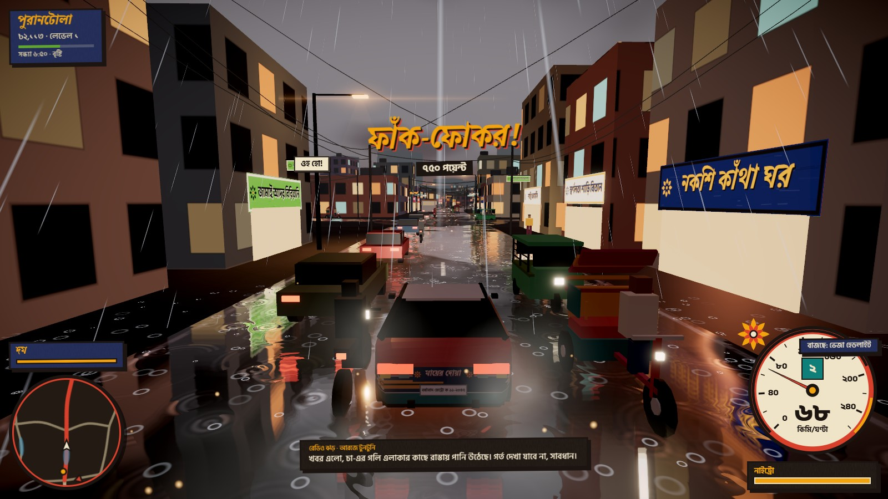
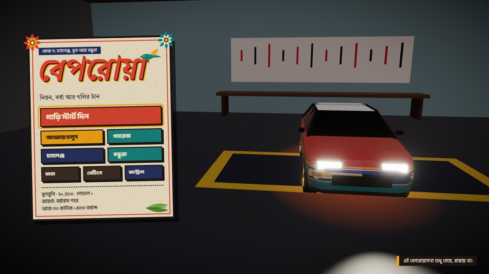
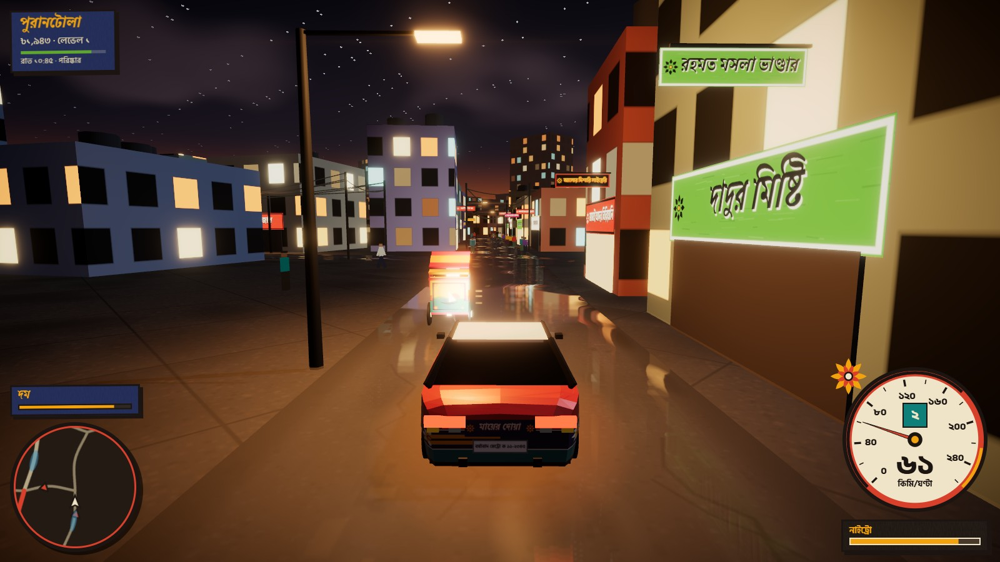
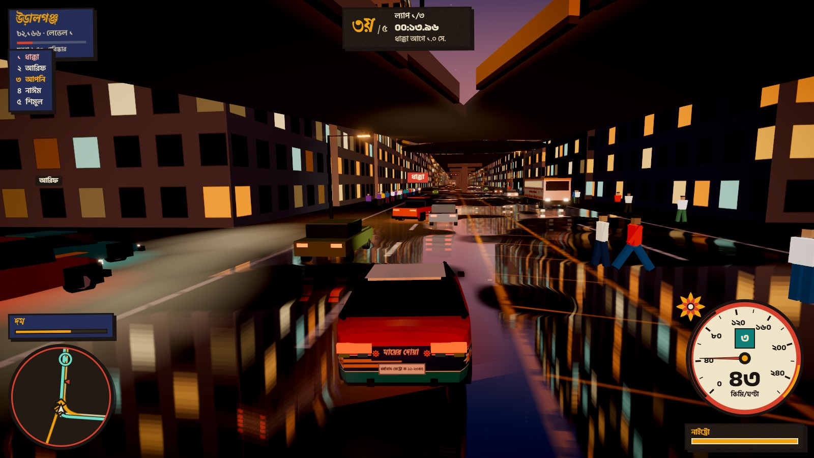
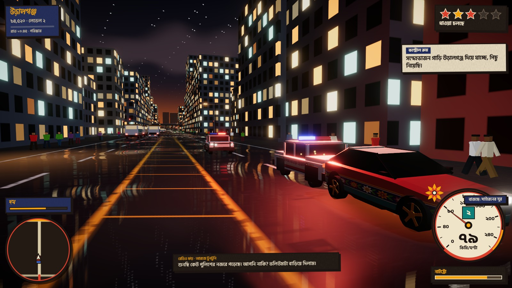
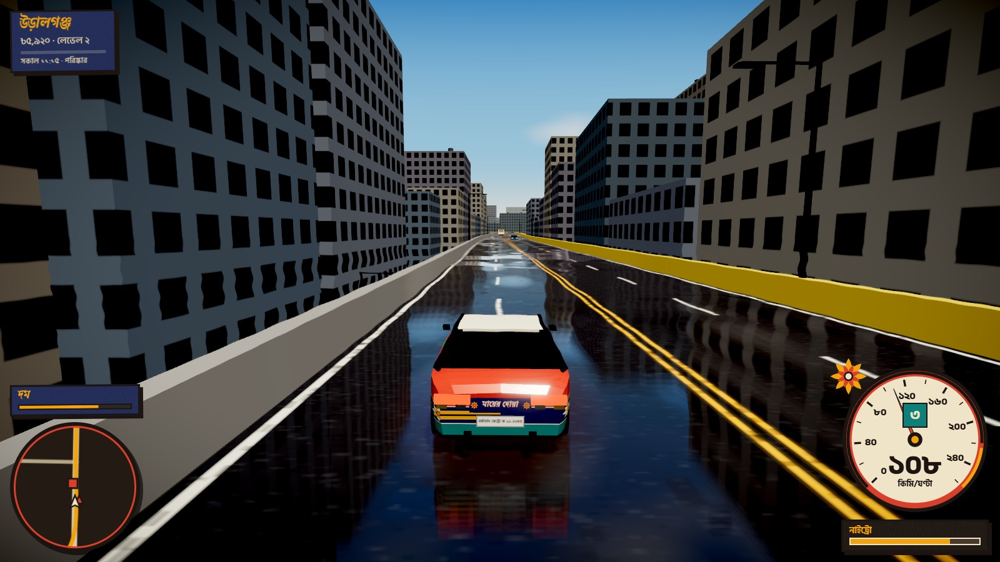
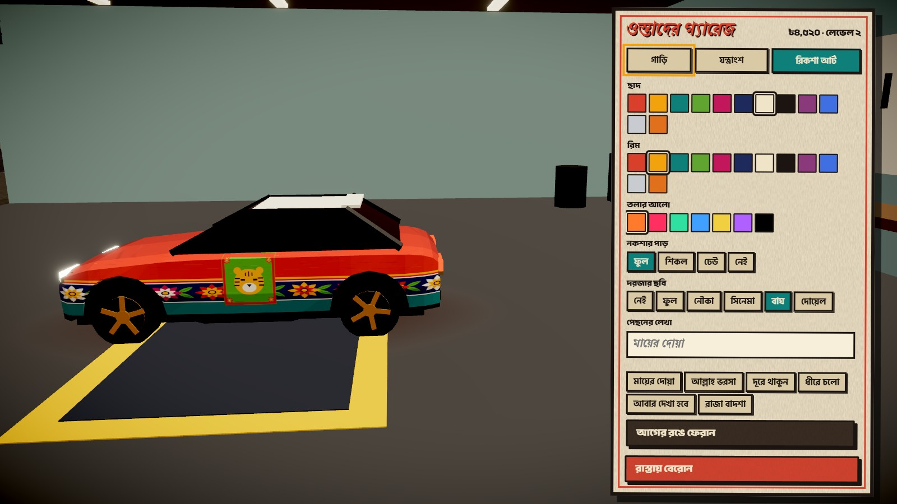
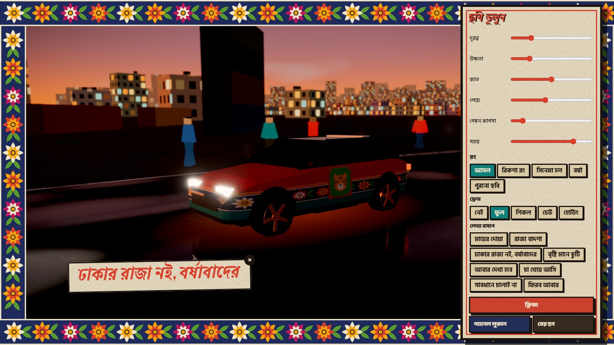
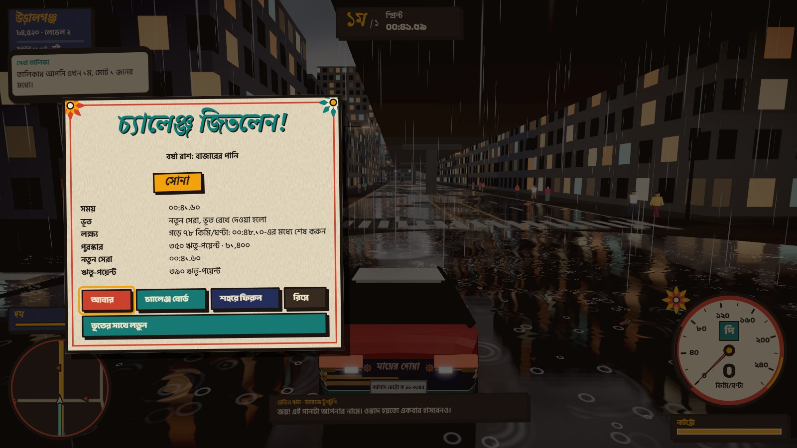
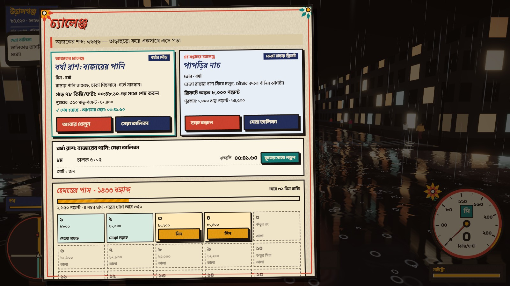

# বেপরোয়া (Beporowa)

**A Bangla-first browser street racer.** Hand-painted rickshaw colours, wet neon roads, a fictional megacity called বর্ষাবাদ (Borshabad).

<p>
  
  
  <a href="https://beporowa.netlify.app"></a>
  <br>
  
  
  
  
  
  
  
  
</p>

বাংলায় পড়ুন: [README.bn.md](README.bn.md)



> **Status: all 7 phases built.** Three districts of a living city, police pursuits, দ্য রিং, a real garage with ten cars, a whole day of weather, photo mode, replays, original music, a Bangla radio DJ, and now ghosts, daily and weekly চ্যালেঞ্জ, a free season pass that follows the Bangla seasons, online leaderboards, races with friends, tilt steering, rumble and accessibility settings. The full plan is in [docs/GDD.md](docs/GDD.md).

**Play it now:** [beporowa.netlify.app](https://beporowa.netlify.app). Best in a desktop browser with a keyboard or a gamepad.

## Screenshots

Captured in the game itself, on the Ultra preset at 1600×900. Every word on screen is the game's own Bangla.

| | |
|---|---|
|  |  |
| **Title screen** in ওস্তাদ's garage | **Night in পুরানটোলা**: wet road, shop signs, a rickshaw ahead |
|  |  |
| **Monsoon**: a flooded street, rain rings, and RJ Tuntuni warning about the water | **The Ring**: third of five under the flyover, rivals' name plates ahead |
|  |  |
| **Three-star chase**: the special unit right behind, police radio and DJ reacting | **Midday on the flyover**: the same city, eleven hours later |
|  |  |
| **Rickshaw-art livery editor**: band, door art and tail slogan | **Photo mode**: sunset, a flower frame and a Bangla caption |
|  |  |
| **Daily challenge won**: gold, ghost kept, season points | **চ্যালেঞ্জ board**: word of the day, leaderboard and the হেমন্ত pass |

## What works in Phase 7

- **Ghosts:** every clean run of a timed event is recorded, 12 samples a second. The best one for each event is kept on this machine and drives beside you as a see-through car, with the live gap to it under the race plate. After a race, **Race the ghost** runs it again alone against your best.
- **চ্যালেঞ্জ, daily and weekly:** everyone gets the same challenge on the same day, worked out from the date on Bangladesh time, so no server is needed for it. Each comes with a Bangla word of the day and its meaning. Challenges are drawn from the bonus modes: time attack, বর্ষার দৌড় (rain rush), রাতের ডেলিভারি (night delivery), fog runs, load-shedding runs, wet drift, **জ্যাম থেকে পালান** (shake off the police in doubled traffic before the clock runs out) and **ছবি শিকার** (photograph the car at a named place, in the right light). Challenge runs are alone on the road under a fixed sky, and never change the Ring ladder.
- **A free season pass by the Bangla seasons:** six seasons from the Bangla calendar, গ্রীষ্ম to বসন্ত, about two months each. Season points come from challenges, races, ghost wins and escapes, and fill 15 tiers of cash, a season paint and glow for the garage, and a stamp you keep. Nothing costs money and nothing can be bought.
- **Online leaderboards:** a Netlify Function keeps a board for every timed event and every daily and weekly challenge, in Netlify Blobs. A time must come with its ghost, which the server checks against the time, the event's start and a speed limit. Names are filtered, and only salted hashes of the connection and the install are kept, never an address. The top ten keep their ghosts, so you can race someone else's line. Where there is no server, the board says so and shows your own best.
- **Racing friends (optional):** a small WebSocket relay in `server/`. Open a room, share its four-letter code, and up to six racers and eight watchers join. The host picks the race and everyone starts on the same moment. Friends' cars are see-through ghosts drawn from their messages, with name plates and triangles on the minimap, and the results fill in as friends finish. Watchers get a chase camera on any racer, switching with ← →.
- **Controls:** phone steering by buttons, an analog slider, or tilting the phone, with a button to straighten and a setting to flip the direction. Gamepad rumble for crashes, police contact, nitro, potholes, traps, the countdown and the finish, and a short buzz on phones for hard knocks. Every driving key can be moved in the Controls screen; Enter, Esc, P, Tab and ` stay put so menus always work.
- **Accessibility:** colour sets for weak red, weak green and weak blue vision, and every minimap marker has its own shape too (racers are diamonds, police squares, friends triangles, the destination a ring). Subtitles from small to huge, an optional solid plate behind them, and a high contrast mode. Reduce Motion from earlier phases still applies everywhere.
- **Optional live AI lines, off by default:** turned on in Settings, and only if the site owner has set a key, some rival taunts and আরজে টুনটুনি lines are written on the spot by Claude through a Netlify Function. Lines are fetched ahead, so nothing ever waits; every line is checked for length, script, rude words, religion and politics, and carries an "AI" tag. Without the key, or offline, the written lines play as before.
- **Quality:** presets Low to Ultra, dynamic resolution and GPU auto-detect from Phase 1. Auto-detect now also reads the machine's memory and cores, and starts newer phone GPUs on Medium.

## From Phase 6

- **A whole day:** the sun rises in the east and sets in the west, in 18 real minutes. Skies, fog, light and colour grading change with the hour. Windows and street lamps come on at dusk, and painted boards take over from the sun. The sun, moon, stars and drifting clouds are all in the sky.
- **Weather by the calendar:** clear, monsoon and fog, blending into each other, and chosen by the real month: rain in the monsoon months, fog in the cold ones. Settings can hold the hour or the weather still.
- **Monsoon:** rain as a single draw call, tilting as you drive into it, with rings on the road, thunder and lightning. The road really gets wetter and slower: grip drops by 12% once it is soaked, and AI drivers take the same bends slower. It dries slowly afterwards.
- **Waterlogging:** eight low roads fill up in a long downpour. Water drags at the car, tyres float at speed and the steering goes light, spray goes up, and potholes hide under the surface. Only ground-level road floods. The low spots are marked on the map.
- **Load-shedding:** after dark the power can go. The dark spreads across the district from a point you can watch, windows and street lamps go out, and only the shop boards and your headlights are left. The police see less far in it.
- **Fog:** visibility closes right in, and the police lose you sooner. Lamps throw visible shafts of light.
- **বর্ষা রাশ:** two new monsoon-only events in the Ring, with the water already up.
- **Wet neon roads:** puddles in the dips, rings from every drop, and mirrored neon that stretches and breaks up. A dry road by day really is dry.
- **Lens flare and heat shimmer:** the sun flares only when nothing hides it, and the road shimmers at noon. Street lamps throw a wide glare, more so in rain.
- **Photo mode (O, or the pause menu):** freezes everything. Orbit the car, set the lens, tilt and background blur, slide the hour along, choose a look, add a rickshaw-art frame, and drag on Bangla captions, ready-made or your own. Saves a PNG at full resolution.
- **Replays:** the last stretch of driving is always kept, with traffic, police and rivals in it. A film director cuts between seven kinds of shot and slows down for crashes and close shaves. You can pick a camera, change speed, drag along the film, or take a photo from it. Open it from the pause menu or a race's results.
- **Adaptive music:** original and generated live, with nothing recorded and no borrowed tune. Lo-fi for cruising, trap and phonk with a dark cowbell for a chase, driving dhol for a race, tabla and ektara at the tea stall, and thinner and darker in rain or a blackout. It follows the stars, the speed and the race, and changes on the bar line. Scales are Bengali-inspired, and the dhol, tabla, ektara and bansuri are synth approximations of those instruments.
- **রেডিও ঝড়:** আরজে টুনটুনি talks over the music, which ducks under her. She reacts to your stars, escapes, arrests, wins, crashes, the rain, the fog, load-shedding and the hour, reads a weather and jam report using real places on the map, and runs mock adverts. Press Y for music and DJ, music only, or off.
- **More to hear:** rain, thunder, wet tyres, rushing water, splashes, birds at dawn, crickets at night, and at last some sounds in the garage.

## From Phase 5

- **ওস্তাদের গ্যারেজ:** a real workshop by the road, and the backdrop of the title screen. Drive in and slow down, or use the title or pause menu. Drag to turn the camera around the car.
- **Ten original cars in three classes, plus one secret:** গলি (বুলবুলি, শালিক, ফড়িং), সড়ক (ইলিশ, মাছরাঙা, চিতল), উড়াল (বাজপাখি, শঙ্খচিল, বাঘা). Each has its own numbers for power, top speed, grip, brakes, nitro and steering. Beat the whole Ring and ওস্তাদ sells you **রিকশা রকেট** for one taka: a rickshaw with a hood, streamers and two big tubes.
- **Six kinds of part, three levels each:** engine, turbo, tyres, suspension, brakes, nitro. They change how the car really drives.
- **Dyno graph:** power against speed, for stock, now, and the next part you point at. It has a crosshair, keyboard control and a table of the numbers.
- **রিকশা আর্ট:** paint six parts of the car, and choose a band of flowers, chain or waves and a door picture of a tiger, doyel, boat, flowers or a cinema face. Type your own Bangla words for the tail, with a filter for rude words, or pick ready-made ones.
- **Money, reputation and levels:** races, stunts, escapes and jobs pay. Reputation sets your level, and levels open better parts. An arrest costs real money. A rolling cash counter sits in the HUD, in Bangla numerals.
- **Damage:** crashes wear the car down. Below 55% it loses power, and below 32% it smokes. The garage repairs it fully.
- **Tea stalls:** three in পুরানটোলা. Stop for a cup, with a little pouring animation. It fills the nitro, mends a puncture, patches the car up to 70% and saves your spot, so the next drive starts there.
- **আড্ডা:** sit with মকবুল মামা, খোকন ভাই, রুমকি, লতিফ চাচা or ডালিম. Each has a short Bangla conversation, rumours and side jobs. Rumours point at each rival's real weakness, and they stay on the Ring board once heard.
- **Side jobs:** eight of them, from delivering against the clock with a GPS route to passing close, drifting, and shaking off the police.
- **আড্ডা mode:** free roam with the police on leave. Start it from the title or pause menu.
- **26 achievements**, most titled with old Bangla proverbs, a **daily reward** by phone with a streak, and a **খাতা** (ledger) for all of it.
- **Rivals keep up:** their engines partly follow the car you bring, so upgrades help without making races trivial. Police follow more loosely.
- **Saves** now live in IndexedDB with a schema number, and older saves are brought forward and paid for what they had earned.

## From Phase 4

- **দ্য রিং:** climb a Top 10 board of original rivals, each with a portrait, a car, a driving style and their own Bangla lines. Each one has a warm-up to finish and then a race to win. A switch on the board opens every race, for anyone who just wants to see them.
- **Twelve kinds of event:**
  - Circuit and sprint, on routes through both districts.
  - **Flyover loop:** laps of the whole flyover, past the toll booth.
  - **River dock:** laps around the new কাজলঘাট container port, under the cranes.
  - **Bazaar maze:** gates deep in the lanes, with no route shown, so finding the way is the race.
  - **Drag:** the handbrake button becomes the gear lever. Shift too early and the engine bogs, too late and it runs out of revs.
  - **Drift:** score points against the clock, and against পাপড়ি in her own race.
  - **Time trial**, with medals by the clock.
  - **Takedown:** cars run from you, and hard hits stop them. A hit from the side counts for more. Nobody is hurt.
  - **Delivery:** fragile cargo to several addresses. Crashes break it, and you must slow down to hand over.
  - **Checkpoint rush:** the clock only grows at each gate.
  - **Boss race:** জাহান, in three legs from the flyover through the lanes to the river, with the police joining partway.
- **Rival personalities:** one cuts through lanes, one never makes a mistake, one apologises and rams you, one takes corners sideways, one is a monster on straights and weak in lanes, one blocks, one drives without lights and honks traffic out of the way, one saves everything for the last lap.
- **Fair rubber-banding:** small and capped both ways, and it fades to nothing before the finish, so the last stretch is always earned. Rivals obey the same physics as you.
- **They remember you:** rivals learn which side you pass on, when you first use nitro, how often you crash and by how much you win. জাহান plans around all of it. It is saved with your career.
- **Starts and finishes:** a start line with lights and a crowd, a perfect-launch timing bonus, a flight along the grid, a rival's face and words before the race, and a results board afterwards with what the rival thinks of it.
- **New district, কাজলঘাট:** a river port with container stacks, gantry cranes, barges, moored launches and country boats on the কাজলগঙ্গা.
- **Horn language:** two taps near a rival now provoke them, so they drive harder and make more mistakes.
- **In the city:** race flags stand at the roadside. Stop beside one to enter it, or press G for the board. ওস্তাদ sends news by phone.

## From Phase 3

- **বিশেষ ধাওয়া ইউনিট:** a fictional police force. Patrols roam the city and give chase if they see you speeding, crashing or hitting them. Their cars use the same physics and controls as yours, so a box-in is real cars blocking you.
- **Heat 1 to 5:** five painted stars. The longer and wilder the chase, the more units, the faster they drive, and the longer they keep searching.
- **Tactics by level:** chase from one star, box-in from two, PIT from three, rams from four, all reacting to where you are heading.
- **Roadblocks and spikes:** barricades across the road ahead always leave a gap. From four stars that gap has a spike strip in it, and units drop strips in front of you. A puncture costs top speed, power and grip until it wears off.
- **Drone and helicopter:** a drone from three stars, with a short battery. A helicopter with a searchlight at five stars. Both can be outrun, and a roof hides you.
- **Getting away:** out of sight is the only way. Parking garages, tea stall crowds, alleys and the ground under the flyover all make the search end sooner. All of them are marked on the map.
- **Arrest:** stop near a unit and a meter fills. More units fill it faster. A fine, then you are back on the road.
- **ঝামেলা-ফাঁদ:** bamboo scaffolds, drum stacks and water tanks by the road. Clip one and it comes down across the road, stunning nearby units, with a moment of slow motion.
- **দম:** hold your breath and time slows down, while the sound goes muffled. Near misses, squeezes, drifts and traps refill it.
- **Three horn taps:** nearby units lose track for a moment, and all of traffic joins in. It needs time to recharge.
- **Bangla police radio:** on-screen chatter from the control room and Chief রেজওয়ান তালুকদার, reacting to what is really happening. If the browser has a Bangla voice it can read them aloud (Settings, off by default).
- **Adaptive difficulty:** keep getting caught and the police ease off a little, escape easily and they push harder. It is saved between sessions.
- **Sound:** a two-tone siren that follows the nearest unit, helicopter rotor, drone whine and radio clicks, all generated in code.

## From Phase 2

- **Two districts of বর্ষাবাদ:** পুরানটোলা's bent alleys and bazaar road, and উড়ালগঞ্জ's avenues. About 15 km of road, with a monument roundabout between them.
- **Flyover:** a 2.6 km elevated loop with four ramps, barriers, pillars and a toll plaza.
- **Traffic:** rickshaws with hand-painted panels, CNG three-wheelers, bikes, cars, pickups and truck-art buses. They follow lanes on the left, as in Bangladesh, keep their distance, and use junctions and a clockwise roundabout.
- **Signals:** 16 signalled junctions with working lights; no vehicle crosses on red.
- **Jam zones:** congested roads that breathe in stop-and-go waves, with bikes filtering between the lanes.
- **ফাঁক-ফোকর:** pass close for a near-miss bonus. Squeeze between two vehicles for a big one, plus nitro.
- **হর্ন ভাষা:** one tap makes traffic pull over, a long horn clears people, two taps and everyone honks back. ওস্তাদ teaches it as you drive.
- **People:** low-detail crowds that walk the pavements and gather at stalls. They always dodge: nobody is ever hit.
- **Crashes:** a bus stops you dead, a rickshaw barely slows you. Nobody is injured.
- **Map and GPS:** a rotating minimap, a full map, turn-by-turn directions in Bangla, re-routing, and a light beacon at the destination.
- **City detail:** hanging Bangla shop boards, tea stalls with steam, spice and fabric stalls, tangled swaying cables, billboards, rooftop water tanks, and city ambience with horns and rickshaw bells.

## Also from Phase 1

- **Arcade driving:** custom raycast vehicle on Rapier physics with suspension, grip, handbrake drift, auto counter-steer, a spin limiter, nitro and a 6-speed automatic.
- **Test road:** a 3.8 km circuit with a drift yard. It is still there for tuning: Settings, then জায়গা.
- **Lap timer and drift score:** sector checks stop short cuts, and your best lap is saved.
- **Vehicle animation:** body roll and pitch on springs, wheel travel, steering, spin, brake and reverse lights, indicators, underglow, exhaust and nitro flames, tyre smoke, skid marks, wet-road spray, impact sparks.
- **Bangla foundation:** every visible string comes from `bn.json` and `en.json`. Bangla numerals by default with a Western toggle, lakh grouping, Bangla ordinals, and a Bengali calendar date.
- **Bangla text rendering:** HTML and Canvas 2D only, so the browser shapes যুক্তাক্ষর correctly. In-world signs are baked into one texture atlas.
- **Look:** planar wet-road reflection, bloom, painted tin-sign HUD and menus. Quality presets Low to Ultra with auto-detect and dynamic resolution.
- **Sound:** procedural engine, turbo, tyres, wind, nitro, horn, backfire and impacts.
- **Input:** keyboard, gamepad and basic touch controls.

## Run it

```bash
npm install
npm run dev
```

Open the URL Vite prints. Other commands:

```bash
npm run build
npm test
```

## Controls

| Action | Keyboard | Gamepad | Touch |
|---|---|---|---|
| Throttle | W / ↑ | RT | গ্যাস |
| Brake and reverse | S / ↓ | LT | ব্রেক |
| Steer | A D / ← → | Left stick | Arrows |
| Handbrake | Space | A | হ্যান্ডব্রেক |
| Nitro | Shift | B | নাইট্রো |
| Horn (tap, two taps, three taps, or hold) | H | RB | হর্ন |
| দম, slow motion (hold) | E | L3 / R3 | দম |
| Map and GPS | M | Back | ম্যাপ |
| The Ring board | G | D-Pad up | রিং |
| Enter a race at a flag, or stop at a tea stall or the garage | Enter | A | Tap the plate |
| Shift up, in a drag race | Space | A | হ্যান্ডব্রেক |
| Change camera | C | Y | – |
| Photo mode | O | Pause menu | Pause menu |
| Radio: music and DJ, music only, or off | Y | Settings | Settings |
| Look back | B | LB | – |
| Back to road | R | X | Pause menu |
| Pause | Esc / P | Start | বিরতি |
| Tuning panel | ` | – | – |
| Watching friends: next or previous driver | ← → | D-Pad left / right | ‹ › on screen |

Driving keys can be moved in **Controls**: press a key button, then the new key. A key taken from another action swaps with it. Phone steering (buttons, slider or tilt) is in **Settings**.

**Drift tip:** pull the handbrake while turning, let go, stay on the throttle and keep steering into the turn. Straighten the wheel to recover. Drifting refills nitro.

## Recorded voice

The DJ's lines can be replaced by real recordings without touching any code. Put the files in `public/voice/`, and list them in `public/voice/manifest.json`:

```json
{ "lines": { "radio.lines.rainStart.0": { "file": "tuntuni-rain-1.ogg", "seconds": 3.2 } } }
```

The key is the line's key in the language file, followed by its place in the list. A line with a recording plays that. Otherwise it uses the browser's Bangla voice if you turned that on, and the words always show on screen.

## Tuning the car

Every number is in [`src/config/tuning.ts`](src/config/tuning.ts). Press ` in the game for live sliders, then use **JSON কপি** to copy your changes.

## Tech stack

Vite, TypeScript, Three.js (WebGL2), Rapier (WASM), pmndrs postprocessing, Web Audio API, Vitest. No frameworks and no external art files.

Physics runs at a fixed 60 Hz with interpolated rendering, and the vehicle code has no rendering dependency, so `npm test` drives it headless.

## Deploy to Netlify

`netlify.toml` is included, with build command `npm run build` and publish directory `dist`. Connect the repo in Netlify, or run:

```bash
npx netlify-cli deploy --build --prod
```

## Online features: setup

Everything online is optional. With no setup the whole game plays, and the online parts say they are offline.

| What | Where it runs | What it needs |
|---|---|---|
| Leaderboards | Netlify Function `netlify/functions/leaderboard.mts`, data in Netlify Blobs | Nothing extra on Netlify. Optional `LEADERBOARD_SALT` environment variable. |
| Live AI lines | Netlify Function `netlify/functions/banter.mts` | `ANTHROPIC_API_KEY` set as an environment variable in Netlify, never in the code. Optional `BANTER_MODEL` (default `claude-opus-5-5`). |
| Friends | `server/relay.js`, on any Node 20+ host that keeps WebSockets open (a small VPS, Fly.io, Render, Railway) | `cd server && npm install && npm start` (port from `PORT`, default 8787), then build the game with `VITE_RELAY_URL=wss://your-relay-host`. |

Locally, `npm run dev` also serves the leaderboard (kept in memory until the server stops) and the AI lines (only if `ANTHROPIC_API_KEY` is set in that shell). For friends, run `node server/relay.js` and open the dev game with `?relay=ws://localhost:8787` on the address; that shortcut only exists in dev builds.

## Known limitations

- Driving feel is tuned from numbers and tests; it still needs tuning by human hands.
- Three districts exist. Roads to the others end at a barricade.
- The whole map stays loaded, since it is still small. Streaming comes with more districts.
- No dents or part damage yet. Crashes give sparks, shake and wobble only.
- People are low detail, and they stay on pavements instead of crossing roads.
- Handcart vendors are not in traffic yet. Traffic wheels do not spin, and rickshaw pullers do not pedal.
- Two vehicles merging at a junction can touch for a moment.
- GPS takes the shortest road and does not avoid jams.
- Rivals' pace and every medal were set by measuring bots, not many hands, so they will need tuning.
- Every car shares the same physics body and chassis, with different numbers. Only the look and the handling differ, not the collision shape.
- রিকশা রকেট looks like a trike, but it still has four wheels in the physics.
- Prices, part values and how rivals follow your car were set by reasoning and headless tests, not by playing a whole career. They will need tuning.
- The rude-word filter is a short list. It catches common words and simple disguises, and it will miss others.
- People at tea stalls appear in the menu, not as figures in the world. Conversations are short trees of a few lines.
- Tea stalls exist only in পুরানটোলা so far.
- Regional dialect lines are light, and were written from general knowledge. A native speaker should check them, especially চট্টগ্রাম and সিলেট.
- Crowds only sway on the spot. There is no flag-waver, and rivals do not get out of their cars yet.
- Rival cars take no damage in a race, and their wheels do not throw smoke.
- Police and rival cars pass through traffic that is far from you, because only vehicles near the player have colliders. Up close they stop, steer around it or crash into it.
- Police do not chase on foot, and their cars do not take damage yet.
- Pursuit balance has been measured by bots and only lightly by hand, so it will need tuning.
- The map has four parking garages for now, and only the ground floor can be driven into.
- Real phones are untested, including the pursuit HUD on small screens.
- Sound has not been reviewed by ear.
- Fog is layered sheets and light shafts, not true volumetric fog, which is too heavy for a mid-range laptop in a browser. SSAO and motion blur are left out for the same reason.
- Lightning, flares, blur and colour grading need the bloom pipeline, so the Low preset does without most of them. It still gets rain, wet roads, floods and the day and night.
- The music and the DJ's timing have only been checked for levels and errors by code, not by ear. Please listen, and tell me what is wrong.
- Rain falls under the flyover too. Only the garages and the workshop keep it off.
- The whole day's look was judged on a few screenshots, so some hours may need more work.
- Traffic does not slow for rain or flood water. Only cars with real physics feel it.
- Azaan at prayer times, from the brief, is left out on purpose. A synthesised version would be disrespectful. If you want it, it needs a real recording used with permission, and the recorded voice system can carry it.
- Tilt and slider steering have not been tried on a real phone. Browsers report tilt differently, so there is a setting to flip it.
- Gamepad rumble has not been felt on a real pad. Chrome and Edge support it; other browsers ignore it.
- The leaderboard's checks catch slips and quick edits, not a determined cheater: a browser game cannot be made cheat-proof. Two runs posted at the same instant can overwrite each other on a board.
- Leaderboards and AI lines exist only on a Netlify deploy, or under `npm run dev`. Other static hosts, and `vite preview`, show the offline message.
- The live AI lines have not been tried with a real key: no call to the API was made while building. The request code is typed against the SDK and tested with a stand-in writer. A daily cap of 600 lines keeps the bill bounded.
- The friends relay cannot run on Netlify. It was tested locally with three browser tabs, not across the internet. Starts can differ by the network delay, there is no reconnect and no chat, and friends' cars pass through each other by design.
- The colour-vision sets cover the HUD and minimap. The 3D world, such as police light bars, is not recoloured.
- Season rewards are cash, paint, glow and stamps. They add no cars or parts.
- Of the brief's bonus modes, Rooftop Stunt Park and the crew and turf system are not built. Rain rush, night delivery, jam escape, photo challenges and time-attack ghost battles are.
- Challenge goals were set from measured course lengths, not from playing them.
- A gamepad can start, pause and resume, but menu navigation needs keyboard, mouse or touch.
- Low preset on phones has no reflection or bloom. Real phone performance has not been measured.
- The radio voice setting uses the browser's own Bangla voice. Most machines do not have one, and then it stays silent. The words are always on screen. Recorded voice lines are not in yet.
- Slang lines are listed in [`src/i18n/review-flags.json`](src/i18n/review-flags.json) for human review.

## Credits

See [CREDITS.md](CREDITS.md) for all fonts (SIL OFL 1.1) and libraries.

This is an original work. It is not affiliated with any game, car maker or brand.

---

<p align="center">
  <i>রাস্তায় সাবধানে চালান, শুধু গেমেই বেপরোয়া হোন।</i><br>
  <sub>Drive carefully on real roads; be reckless only in the game.</sub>
</p>
